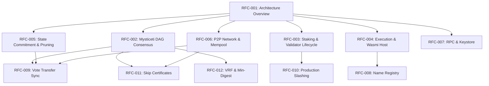

# Kovanica RFC Catalog & Specification Index

Ovaj direktorij sadrži službenu seriju internih **RFC (Request for Comments)** tehničkih specifikacija za **Kovanica** Layer-1 blockchain.

Svi dokumenti predstavljaju **ground-truth** specifikaciju sustava i strogo su referencirani na izvorni kod u radnom prostoru (`crates/...`).

---

## 1. Master Tablica RFC Specifikacija

| RFC # | Naziv specifikacije | Status | Domena i Crate-ovi | Primarni opseg |
|---|---|---|---|---|
| [**RFC-001**](RFC-001-ARCHITECTURE-AND-SYSTEM-OVERVIEW.md) | **Kovanica Architecture & System Overview** | **Active** | Cijeli Workspace (27 crates) | Arhitekturni slojevi, deterministički model, granice podsustava, konstante lanca ($4\text{ s}$ runda, $12\text{ s}$ lider). |
| [**RFC-002**](RFC-002-MYSTICETI-DAG-CONSENSUS-AND-LEADER-LOGIC.md) | **Mysticeti-style Uncertified DAG Consensus & Skipped Leader Logic** | **Active** | `kovanica-consensus`, `kovanica-dag`, `kovanica-types` | Wave=3 konsenzus, direct/indirect commit pravila, `SkipCert` kvorumi, `MysticGhost` linearizacija ($k=3$). |
| [**RFC-003**](RFC-003-STAKING-EPOCHS-AND-VALIDATOR-LIFECYCLE.md) | **Staking, Epoch Transitions & Validator Lifecycle** | **Active** | `kovanica-staking`, `kovanica-crypto`, `kovanica-types` | Zaključana tokenomika (90.2M total, 2.5 KUNA nagrada, era 8.1M, decay 3/4), aktivni set 15–21, epohe ($7\,200$ rundi), slashing (5%) i jail. |
| [**RFC-004**](RFC-004-EXECUTION-ENGINE-AND-WASMI-HOST-ENVIRONMENT.md) | **Execution Engine & Wasmi Host Environment** | **Active** | `kovanica-execution`, `kovanica-runtime`, `kovanica-common`, ugovori | Transakcijski model, `Call.value`, Wasmi mjerenje goriva (fuel), `ContractHost` sustav skrbništva (custody ledger), atomic rollback. |
| [**RFC-005**](RFC-005-STATE-COMMITMENT-PRUNING-AND-VERIFIABLE-STATE-SYNC.md) | **State Commitment, Pruning & Verifiable State Sync** | **Active** | `kovanica-storage`, `kovanica-types`, `kovanica-network` | BLAKE3 Sparse Merkle Tree (`AccountSmt`), `aux-state leaf binding` na adresi `[0xff; 32]`, rezanje povijesti (2000 state roots), snimak stanja (`KVSNSP01`). |
| [**RFC-006**](RFC-006-P2P-NETWORK-PROTOCOL-AND-MEMPOOL.md) | **P2P Network Protocol & Mempool Specification** | **Active** | `kovanica-network`, `kovanica-mempool` | libp2p stog (TCP, Noise, Yamux, Gossipsub v1.2), izolacija tema po lancu (`kovanica/<tag>/...`), protokol `block-sync/1.1.0`, prioritizacija po fee-rateu, RBF zamjena. |
| [**RFC-007**](RFC-007-RPC-AND-KEYSTORE-SPECIFICATION.md) | **RPC & Keystore Specification** | **Active** | `kovanica-rpc`, `kovanica-keystore`, `kovanica-types` | JSON-RPC 2.0 i WebSocket pretplate, kanonski bech32 format (`kvnc...dag`, 64 znaka), rukovanje legacy adresama, Keystore v2 (Argon2id + XChaCha20-Poly1305 + 0600 prava). |
| [**RFC-008**](RFC-008-NAME-REGISTRY.md) | **Name Registry Contract (`kovanica-name-registry`)** | **Active** | `kovanica-name-registry`, `kovanica-execution` | Decentralizirani registar imena, first-come pravilo, enumeracijska otpornost, normalizacija naziva. |
| [**RFC-009**](RFC-009-VOTE-TRANSFER-OVER-BLOCK-SYNC.md) | **Vote Transfer Over Block Sync (Late-Join Catch-Up)** | **Implemented** | `kovanica-network`, `kovanica-consensus`, `kovanica-storage` | Prijenos konsenzusnih glasova preko `block-sync` protokola za otklanjanje zastoja sinkronizacije novih čvorova. |
| [**RFC-010**](RFC-010-PRODUCTION-SLASHING.md) | **Production Slashing: Verifiable Evidence and Unbonding Coverage** | **Implemented (Gated)** | `kovanica-staking`, `kovanica-types`, `kovanica-consensus` | Dokazi o ekvivokaciji (`EquivocationEvidence`), automatski odbitak 5% uloga i pokrivanje unbonding reda. |
| [**RFC-011**](RFC-011-SKIP-CERTIFICATES.md) | **Leader-Slot Timeouts and Skip Certificates (PRO-40 (b))** | **Implemented** | `kovanica-consensus`, `kovanica-types`, `kovanica-network` | Kvorumski verificirani certifikati preskakanja (`SkipCert`) nakon isteka $T_\text{skip}$ bez blokiranja committera. |
| [**RFC-012**](RFC-B1-B2-VRF-AND-MIN-DIGEST.md) | **VRF Leader Election (B1) and Min-Digest Fork Resolution (B2)** | **Draft / Gated** | `kovanica-crypto`, `kovanica-consensus`, `kovanica-dag` | Izbor lidera putem 96-bajtnog ECVRF dokaza i automatska zamjena leksikografski manjim hešom u slučaju račvanja. |

---

## 2. Graf međuovisnosti RFC specifikacija

---

## 3. Životni ciklus i pravila izmjena RFC-a

1. **Strogo poštivanje invarijanti:**
   - Niti jedan RFC ne smije mijenjati zaključane tokenomske parametre iz [`AGENTS.md`](file:///AGENTS.md) i `RFC-003` bez eksplicitnog odobrenja vlasnika projekta.
   - Svaka specifikacija mora očuvati determinizam izvršavanja i konsenzusa (bez ovisnosti o lokalnom satu, floating-point operacijama ili nedeterminističkim nasumičnim generatorima).
2. **Kriteriji statusa:**
   - **Draft:** Prijedlog u razradi; nije dio produkcijskog koda.
   - **Implemented (Gated):** Značajka implementirana u repozitoriju, ali zaštićena prekidačem (npr. `SLASHING_ACTIVE_FROM_ROUND = u64::MAX`).
   - **Implemented / Active:** Produkcijski aktivan kod na mreži.
   - **Superseded:** Zastarjela specifikacija zamijenjena novijim RFC-om.
