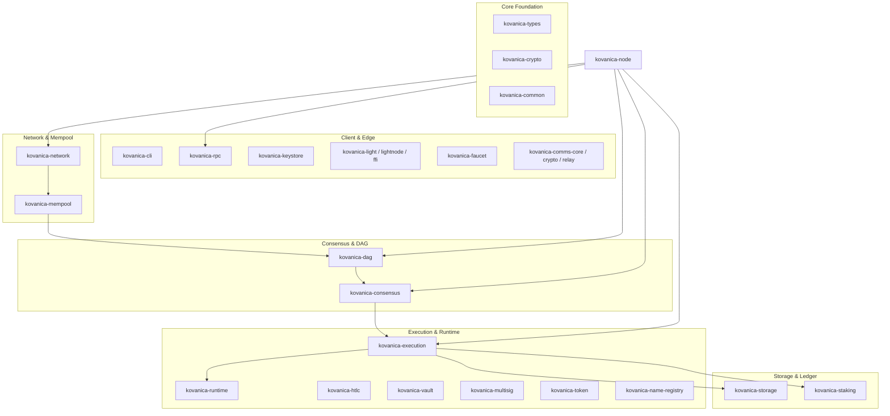

# RFC-001 — Kovanica Architecture & System Overview

- **Status:** Canonical / Active (Ground-Truth Specification)
- **Crate Scope:** Entire Workspace (27 crates)
- **Primary References:**
  - Workspace root: [`Cargo.toml`](file:///crates/../Cargo.toml)
  - Core entrypoint: [`crates/kovanica-node/src/main.rs`](file:///crates/kovanica-node/src/main.rs), [`crates/kovanica-node/src/config.rs`](file:///crates/kovanica-node/src/config.rs)
  - Shared types: [`crates/kovanica-types/src/lib.rs`](file:///crates/kovanica-types/src/lib.rs)
  - Common runtime contracts: [`crates/kovanica-common/src/lib.rs`](file:///crates/kovanica-common/src/lib.rs)
  - Baseline architecture: [`docs/ARCHITECTURE.md`](file:///docs/ARCHITECTURE.md), [`AGENTS.md`](file:///AGENTS.md)

---

## 1. Sažetak (Executive Summary)

Kovanica je neovisan Layer-1 blockchain napisan od nule u programskom jeziku Rust (izdanje 2021/2024). Sustav kombinira visoko-propusni, necificirani asinkroni DAG konsenzus (Mysticeti-style s parametrom vala $W=3$), determinističko Wasmi WebAssembly okruženje za pametne ugovore, ugrađeni model ulaganja (Proof-of-Stake s 15–21 aktivnim validatorom) i hijerarhijsku trajnu pohranu baziranu na ugrađenom `redb` pogonu.

Arhitektura je modularno raspodijeljena na 27 radnih prostora (workspace crates) koji strogo poštuju separaciju odgovornosti, determinizam u svakoj fazi obrade, niske memorijske zahtjeve (targetirano za VPS strojeve od 2–4 GB RAM-a) i eliminaciju nedeterminističkih efekata (vrijeme, plutajući zarez, nasumičnost) iz konsenzusnog i izvršnog toka.

---

## 2. Podjela domena i radni prostor (Workspace Crates)

Svih 27 crate-ova repozitorija grupirano je u 6 funkcionalnih domena:



### 2.1 Tablica odgovornosti crate-ova

| Crate | Domena | Primarna odgovornost i granice |
|---|---|---|
| `kovanica-types` | Core | Kanonski primitivi: `Block`, `Transaction`, `Address`, `Vote`, `Hash`, `Round`, `WAVE_LENGTH`, `EPOCH_ROUNDS`. |
| `kovanica-crypto` | Core | Kriptografija: BLAKE3, Ed25519 potpisivanje i verifikacija, ECVRF witness i proof generiranje. |
| `kovanica-common` | Core | Zajednički contract ABI, `Host` trait, `ContractError`, fiksni tipovi valute i heširanja. |
| `kovanica-storage` | Storage | Trajna `redb` pohrana: `BlockStore`, `StateStore`, `ConsensusStore`, `AddressTxIndex`. |
| `kovanica-dag` | Consensus | Kauzalni usmjereni aciklički graf blokova (`BlockManager`, `DagStore`, `mergeset`). |
| `kovanica-consensus` | Consensus | Mysticeti committer (`BaseCommitter`, `UniversalCommitter`), direct/indirect odluke, `MysticGhost` linearizator, skip certifikati. |
| `kovanica-mempool` | Network | Prioritizirani mempool po fee-rateu, RBF zamjene transakcija, validacija stanja računa i nonce sekvenci. |
| `kovanica-network` | Network | libp2p stog (TCP, Noise, Yamux, Gossipsub v1.2, Kademlia DHT), `block-sync/1.1.0`, state sync. |
| `kovanica-runtime` | Execution | Wasmi deterministički interpretator, mjerenje goriva (fuel/gas metering), učitavanje modula. |
| `kovanica-execution` | Execution | Primjena transakcija na stanja, upravljanje `ContractHost` sustavom skrbništva (custody ledger), naplata nagrada. |
| `kovanica-staking` | Ledger | Stanje ulaganja (`StakingState`), raspodjela nagrada, linearno otključavanje riznice, rotacija validatora. |
| `kovanica-node` | Runtime | Središnji orkestrator i demon (`main.rs`, `config.rs`), povezivanje P2P-a, DAG motora, izvršavanja i RPC-a. |
| `kovanica-rpc` | Client | JSON-RPC 2.0 i WebSocket API poslužitelj, OpenAPI specifikacije, mjere zaštite (rate-limiting, CORS). |
| `kovanica-keystore` | Client | Sigurna pohrana ključeva (Argon2id + XChaCha20-Poly1305 v2 format), Unix/Windows provjere dopuštenja datoteka. |
| `kovanica-cli` | Client | CLI sučelje za operatere čvorova, upravljanje novčanicima, slanje transakcija i nadzor. |
| `kovanica-htlc` | Contracts | Nativni Hash Time-Locked Contract modul (sigurno atomsko zaključavanje i povrat). |
| `kovanica-vault` | Contracts | Nativni vremenski zaključani trezori (timelock vestings sa shemom raspodjele). |
| `kovanica-multisig` | Contracts | Nativni višekorisnički novčanik ($M$-of-$N$ threshold potpisivanje). |
| `kovanica-token` | Contracts | Nativni standard za zamjenjive tokene (KRC-20 ekvivalent: transfer, mint, burn, approval). |
| `kovanica-name-registry`| Contracts | Nativni decentralizirani registar imena (DNS/ENS ekvivalent na Kovanici). |
| `kovanica-light` | Light Client | Klijentske strukture laganog čvora, verifikacija vrha i dokaza zaglavlja. |
| `kovanica-lightnode` | Light Client | Izvršni demon laganog klijenta s niskim resursnim otiskom. |
| `kovanica-light-ffi` | Light Client | C-FFI most za integraciju laganog čvora u mobilne i vanjske aplikacije. |
| `kovanica-faucet` | Tools | Servis za automatsko dijeljenje testnih KUNA tokena developerima. |
| `kovanica-comms-core` | Comms | Protokol end-to-end šifriranih poruka preko Kovanica čvorova. |
| `kovanica-comms-crypto`| Comms | X25519 razmjena ključeva i ChaCha20-Poly1305 omotnice za poruke. |
| `kovanica-comms-relay` | Comms | Relejni poslužitelj za asinkronu dostavu šifriranih poruka. |

---

## 3. Protokolni tok i životni ciklus bloka

Obrada podataka kroz Kovanica L1 slijedi strogo definiran slijed:

```
[Klijent / RPC / CLI]
        │  kovanica_sendRawTransaction
        ▼
[Mempool] (FIFO/Fee-rate, Nonce provjera, Provjera stanja računa)
        │
        ▼
[DAG Proizvođač Bloka] (Periodički tiktak svake 4 sekunde: StatementBlock)
        │
        ▼
[P2P Gossipsub] (Tema: "blocks", autentificirano potpisom autora)
        │
        ▼
[DAG Store & BlockManager] (Verifikacija roditelja, kauzalno uvezivanje, mergeset)
        │
        ▼
[Consensus Engine & UniversalCommitter] (Wave = 3, Direct/Indirect commit pravila)
        │  generira CommittedSubDag (lineariziran preko MysticGhosta)
        ▼
[Execution Layer] (Primjena transakcija, Wasmi runtime, transferi, ugovori)
        │  poziva StakingState::on_leader_committed (dodjela bloka autoru)
        ▼
[State Commitment & Storage] (Ažuriranje AccountSmt, aux-state leaf binding u redb)
```

### 3.1 Ključni mrežni i vremenski parametri

| Parametar | Vrijednost u kodu | Izvorišna lokacija |
|---|---|---|
| Trajanje runde (`round_duration`) | $4\,000\text{ ms}$ (4 sekunde) | `crates/kovanica-node/src/config.rs:17` |
| Duljina vala konsenzusa | $W = 3$ runde | `crates/kovanica-types/src/lib.rs:64` |
| Interval potvrđenog lidera | $12\text{ s}$ ($3 \times 4\text{ s}$) | `crates/kovanica-staking/src/lib.rs:70` |
| Duljina epohe (DAG runde) | $7\,200$ rundi ($\approx 8\text{ sati}$) | `crates/kovanica-types/src/lib.rs:93` |
| Duljina epohe (visine lidera) | $2\,400$ potvrđenih lidera | `crates/kovanica-types/src/lib.rs:97` |
| Maksimalni gap roditelja bloka | $300$ rundi | `crates/kovanica-types/src/lib.rs:134` |
| Maksimalan broj transakcija po bloku | $10\,000$ tx | `crates/kovanica-types/src/lib.rs:137` |
| Gornja granica plina po transakciji | $10\,000\,000$ gas | `crates/kovanica-types/src/lib.rs:146` |

---

## 4. Deterministički model sustava (Invarijante)

1. **Apsolutna odsutnost nedeterminizma u izvršenju:**
   - Wasmi interpretator (`kovanica-runtime`) koristi strogo determinističko mjerenje instrukcija putem goriva (fuel). Zabranjeni su opkodovi i uvozi koji se oslanjaju na sat računala, sistemski slučajni generator (`rand`) ili operacije s pomičnim zarezom koje ovise o hardverskoj arhitekturi.
2. **Determinizam linearizacije pod-grafa:**
   - Za svaki odlučeni blok lidera, skup njegovih predaka koji još nisu predani sortira se determinističkim topološkim algoritmom (`colour_mergeset` u `ghostdag_scoped.rs` ili primarni `linearizer.rs`). Poredak transakcija unutar istog sub-DAG-a je identičan na svim čvorovima u mreži.
3. **Deterministička serijalizacija:**
   - Za heširanje i potpisivanje koristi se strogo specificiran `bincode` (Little-Endian, fiksna širina riječi) ili namjenske domenske domene (`SigningContext`), što eliminira ranjivosti neusklađenih binarnih reprezentacija.
4. **Izolacija pohrane (Single-Writer MVCC):**
   - Transakcije izvršavanja primjenjuju se atomski unutar jedne `redb::WriteTransaction`. Ako bilo koji dio poziva ugovora padne, stanje se vraća na početak bez parcijalnih mutacija.

---

## 5. Sigurnosni mehanizmi

- **Izolacija lanaca (Network Separation):** P2P protokoli i Gossipsub teme prefiksirani su jedinstvenom mrežnom oznakom `kovanica/<chain_id>-<genesis_prefix>/<topic>`. Poruke iz testneta ili devneta ne mogu dospjeti u obradu na glavnoj mreži.
- **Domensko razdvajanje potpisa:** Svaki potpis (blok, transakcija, glas, timeout, certifikat pečata) pokriva specifičan domenski tag (`KUNA/tx/v1`, `KUNA/block/v1`, `KUNA/vote/v1`, `KUNA/timeout/v1`).
- **Otpornost na memorijsko iscrpljivanje (DoS):**
   - Bounded mrežni tokovi (svaki mrežni frame je strogo ograničen na najviše $1\text{ MiB}$).
   - Mempool odbacuje transakcije s nedovoljnim fee-rateom i ograničava broj transakcija po pošiljatelju (`max_txs_per_sender`).
   - Pruning DAG memorije automatski čisti blokove ispod sigurnosnog prozora (`prune_window_waves`).

---

## 6. Točne reference u kodu

- Granice konfiguracije čvora: [`crates/kovanica-node/src/config.rs`](file:///crates/kovanica-node/src/config.rs#L10-L150)
- Orkestracija podizanja podsustava: [`crates/kovanica-node/src/main.rs`](file:///crates/kovanica-node/src/main.rs#L120-L450)
- Kanonski tipovi i konstante: [`crates/kovanica-types/src/lib.rs`](file:///crates/kovanica-types/src/lib.rs#L55-L165)
- Standardni formati adresa: [`crates/kovanica-types/src/address.rs`](file:///crates/kovanica-types/src/address.rs#L8-L45)
- Upravljanje bazom i tablicama: [`crates/kovanica-storage/src/lib.rs`](file:///crates/kovanica-storage/src/lib.rs#L35-L95)
