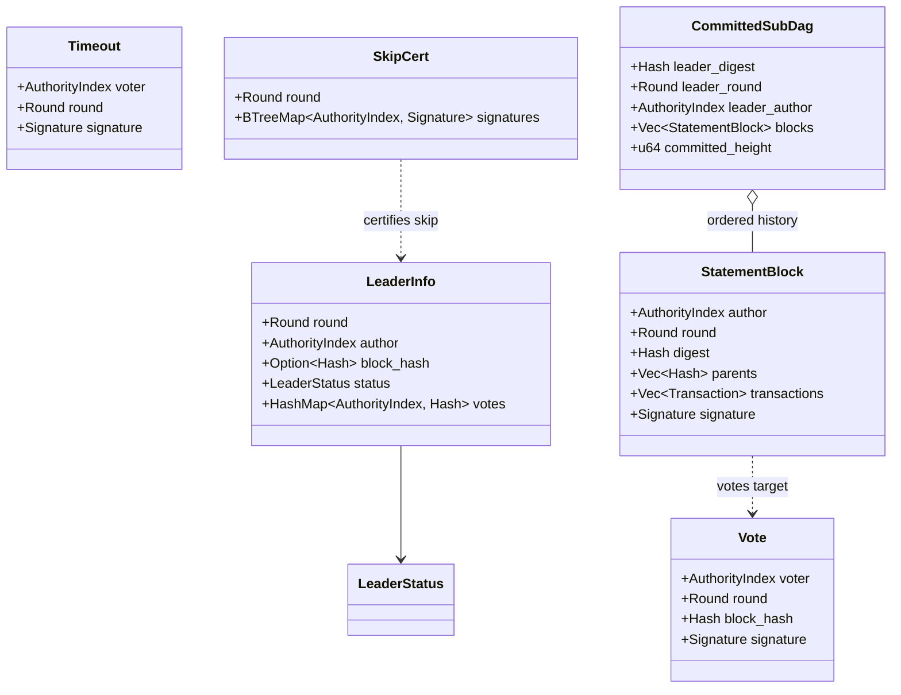
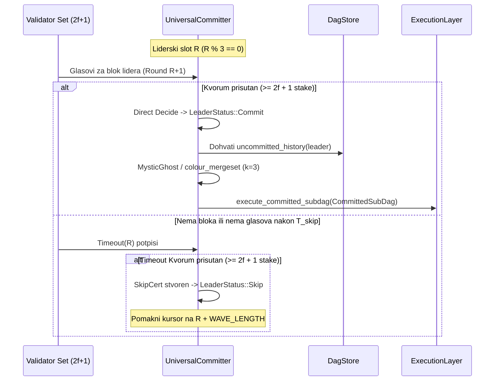

# RFC-002 — Mysticeti-style Uncertified DAG Consensus & Skipped Leader Logic

- **Status:** Canonical / Active (Ground-Truth Specification)
- **Crate Scope:** `kovanica-consensus`, `kovanica-dag`, `kovanica-types`
- **Primary References:**
  - Committer core: [`crates/kovanica-consensus/src/committer.rs`](file:///crates/kovanica-consensus/src/committer.rs)
  - Engine orchestration: [`crates/kovanica-consensus/src/engine.rs`](file:///crates/kovanica-consensus/src/engine.rs)
  - Skip certificates: [`crates/kovanica-consensus/src/skip.rs`](file:///crates/kovanica-consensus/src/skip.rs), [`crates/kovanica-types/src/timeout.rs`](file:///crates/kovanica-types/src/timeout.rs)
  - MysticGhost linearizer: [`crates/kovanica-consensus/src/mysticghost.rs`](file:///crates/kovanica-consensus/src/mysticghost.rs), [`crates/kovanica-consensus/src/ghostdag_scoped.rs`](file:///crates/kovanica-consensus/src/ghostdag_scoped.rs)
  - Mergeset & DAG store: [`crates/kovanica-dag/src/dag_store.rs`](file:///crates/kovanica-dag/src/dag_store.rs), [`crates/kovanica-dag/src/mergeset.rs`](file:///crates/kovanica-dag/src/mergeset.rs)
  - Previous related RFCs: [`RFC-009-VOTE-TRANSFER-OVER-BLOCK-SYNC.md`](file:///docs/rfcs/RFC-009-VOTE-TRANSFER-OVER-BLOCK-SYNC.md), [`RFC-011-SKIP-CERTIFICATES.md`](file:///docs/rfcs/RFC-011-SKIP-CERTIFICATES.md)

---

## 1. Sažetak (Executive Summary)

Kovanica implementira visoko-performantni konsenzus baziran na necificiranom usmjerenom aciklićkom grafu (uncertified DAG) po uzoru na Mysticeti protokol. Za razliku od tradicionalnih BFT sustava koji zahtijevaju certifikaciju svakog bloka prije prelaska na sljedeću rundu, Kovanica omogućuje validatorima da predlažu blokove asinkrono na svakom otkucaju runde ($4\text{ s}$), dok se finalizacija odvija u valovima ($W = 3$ runde).

Za svaki val deterministički se određuje lider. Lider se finalizira ("direktno odlučuje") ako prikupi kvorum glasova ($2f + 1$ uloga) validatora iz sljedeće runde, ili "indirektno" kroz kauzalnu povezanost s kasnijim potvrđenim liderom. Kako bi se spriječilo zapinjanje lanca (chain stall) kada je lider nedostupan ili zlonamjeran, implementiran je mehanizam kvorumski verificiranih certifikata preskakanja (`SkipCert`), dok se linearizacija kauzalne povijesti provodi determinističkim algoritmom `MysticGhost` (GHOSTDAG prilagođen valovima) koji razvrstava blokove u "plave" (potvrđene) i "crvene" (odbačene, čije se transakcije vraćaju u mempool).

---

## 2. Podatkovne strukture konsenzusa



### 2.1 Ključne definicije u kodu

- **Runda i val:**
  ```rust
  pub type Round = u64;
  pub const WAVE_LENGTH: u64 = 3;
  ```
  Liderske runde su one na početku vala: `round % WAVE_LENGTH == 0` (za `round > 0`).
- **Status lidera (`LeaderStatus` u `crates/kovanica-consensus/src/types.rs`):**
  - `Undecided`: još nema dovoljno glasova ili certifikata.
  - `Commit`: lider je izglasan direktno ili indirektno povezan s kasnijim potvrđenim liderom.
  - `Skip`: lider je preskočen (nema kauzalnog puta do kasnijeg lidera ili posjeduje verificirani `SkipCert`).

---

## 3. Pravila odlučivanja (Direct and Indirect Decide)

Konsenzusni committer (`BaseCommitter` i `UniversalCommitter`) obrađuje runde lidera u strogo rastućem redoslijedu.



### 3.1 Direktna odluka (`try_direct_decide`)
Izvodi se u `crates/kovanica-consensus/src/committer.rs:36`:
1. Provjerava se ima li lider u krugu $R$ registriran blok heš $H_L$.
2. Provjerava se zbroj uloga validatora koji su glasali za $H_L$ u rundi $R+1$.
3. Ako vrijedi $\sum_{\text{voters}} \text{stake} \ge 2f + 1$, status postaje `LeaderStatus::Commit`.

### 3.2 Indirektna odluka (`try_indirect_decide`)
Ako liderski krug $R$ nije prikupio direktni kvorum, committer provjerava kasnije lidere unutar istog ili kasnijeg vala koji su dobili status `Commit`:
1. Ako postoji kasniji potvrđeni lider $L_{\text{later}}$ i u DAG-u postoji kauzalni put od $L_{\text{later}}$ do $L_R$ (`has_path(dag_store, L_R, L_{\text{later}}) == true`), tada $L_R$ prelazi u `LeaderStatus::Commit`.
2. Ako kauzalni put **ne postoji**, $L_R$ prelazi u `LeaderStatus::Skip`.

---

## 4. Logika preskakanja lidera (Skipped Leader & Skip Certificates)

Kako bi se spriječilo zlonamjerno forkanje ili lokalno desinkroniziranje čvorova uslijed različitih lokalnih timeouta (riješeno u PRO-35 i PRO-40), preskakanje neaktivnog lidera strogo je determinističko:

### 4.1 Pravila timeouta (`crates/kovanica-consensus/src/skip.rs`)
1. Ako validator pričeka $T_{\text{skip}}$ bez zaprimanja validnog bloka i glasova za lidersku rundu $R$, potpisuje strukturu `Timeout`:
   $$\text{Digest} = \text{BLAKE3}(\text{"KUNA/timeout/v1"} \parallel \text{chain\_id} \parallel \text{genesis\_hash} \parallel \text{epoch}(R) \parallel \text{voter} \parallel R)$$
2. Validatori razmjenjuju `Timeout` poruke preko Gossipsub teme `"timeouts"`.
3. Kada čvor prikupi nepotpisane duplikate od skupa validatora čiji ulog prelazi prag kvoruma:
   $$\sum_{i \in \text{signers}} \text{stake}_i \ge \text{quorum} \quad (2f + 1)$$
   stvara se `SkipCert`.
4. **Invarijanta sigurnosti:** Zbog presjeka kvoruma od $2f + 1$ na skupu od $3f + 1$ validatora, bilo koji skup za glasanje (commit) i bilo koji skup za preskakanje (skip) moraju sadržavati barem jednog poštenog validatora. Pošten validator nikada ne potpisuje i glas i timeout za isti liderski krug.

### 4.2 Vote Transfer over Block Sync (RFC-009)
Čvor koji se naknadno spoji na mrežu (late-joiner) sinkronizira blokove, ali ne može dostići kvorum bez glasova koji su ranije emitirani samo preko prolaznog Gossipsuba. Zato `kovanica-network` implementira proširenje protokola za sinkronizaciju:
- Zahtjev: `BlockSyncRequest::VotesForRound { round: Round }`
- Odgovor: `BlockSyncResponse::Votes { votes: Vec<Vote> }`
- Trajno spremanje glasova u tablici `VOTES` baze `redb` (`crates/kovanica-storage/src/consensus_store.rs`).

---

## 5. MysticGhost linearizacija i rukovanje crvenim blokovima

Nakon što je lider potvrđen, svi njegovi neizvršeni preci moraju se linearizirati u jedinstven, deterministički niz transakcija.

### 5.1 Scoped GHOSTDAG algoritam (`ghostdag_scoped.rs`)
- Parametar pohlepe: $k = 3$.
- Sigurnosni limit mergeseta: `max_mergeset_blocks = 2_000` (`crates/kovanica-consensus/src/mysticghost.rs:26`). Ako skup nepredanih blokova prijeđe limit, sustav koristi sigurni fallback linearni topološki redoslijed.
- Blokovi se dijele na:
  - **Plavi blokovi (Blue blocks):** Pripadaju glavnom kauzalnom lancu i stabilnoj zoni. Njihove se transakcije izvršavaju redoslijedom određenim GHOSTDAG topologijom.
  - **Crveni blokovi (Red / Non-blue blocks):** Kauzalni blokovi koji su stigli prekasno ili izvan $k$-granice. Njihove se transakcije **ne izvršavaju** u sklopu tog sub-DAG-a.

### 5.2 Vraćanje transakcija u Mempool (`reinsert_returned`)
Kako korisnici ne bi gubili poslane transakcije koje su završile u "crvenim" blokovima, Kovanica implementira deterministički mehanizam oporavka:
- Izvršni sloj vraća transakcije iz crvenih blokova u mempool pozivom:
  `mempool.reinsert_returned(red_txs, false)` (`crates/kovanica-mempool/src/lib.rs:297`).
- Transakcije se ponovno validiraju i čekaju sljedeću priliku za uvrštavanje u novi blok, bez penalizacije pošiljatelja ili mrežnih susjeda.

---

## 6. Sigurnosni mehanizmi i tolerancija na greške

1. **Stall-Freedom:** Čvor nikada ne preskače neodlučenog lidera na temelju lokalnog sata bez `SkipCert` certifikata. Time se eliminiraju rascjepi stanja (chain forks) uzrokovani mrežnim kašnjenjem.
2. **Zaštita od ekvivokacije (Double-Signing):** Ako predlagatelj bloka potpiše dva različita bloka za istu rundu, mehanizam detekcije u `crates/kovanica-consensus/src/engine.rs` izolira oba zaglavlja i generira dokaz o dvostrukom potpisivanju (`EquivocationEvidence`).
3. **Deterministički Anchor za State Sync:** Kada čvor primijeni verificirani snapshot, `certified_catchup_anchor` u `DagStore` sprječava ponovno izvršavanje već primijenjenih predaka lidera.

---

## 7. Točne reference u kodu

- Mysticeti Committer logika: [`crates/kovanica-consensus/src/committer.rs:22-135`](file:///crates/kovanica-consensus/src/committer.rs#L22-L135)
- Kauzalna povijest bez duplikata: [`crates/kovanica-consensus/src/committer.rs:185-223`](file:///crates/kovanica-consensus/src/committer.rs#L185-L223)
- Skip certifikati i timeout verifikacija: [`crates/kovanica-consensus/src/skip.rs:58-115`](file:///crates/kovanica-consensus/src/skip.rs#L58-L115)
- MysticGhost konfiguracija i parametri: [`crates/kovanica-consensus/src/mysticghost.rs:13-37`](file:///crates/kovanica-consensus/src/mysticghost.rs#L13-L37)
- Upravljanje DAG skladištem: [`crates/kovanica-dag/src/dag_store.rs:40-180`](file:///crates/kovanica-dag/src/dag_store.rs#L40-L180)
- Ekstrakcija mergeseta: [`crates/kovanica-dag/src/mergeset.rs:15-65`](file:///crates/kovanica-dag/src/mergeset.rs#L15-L65)
