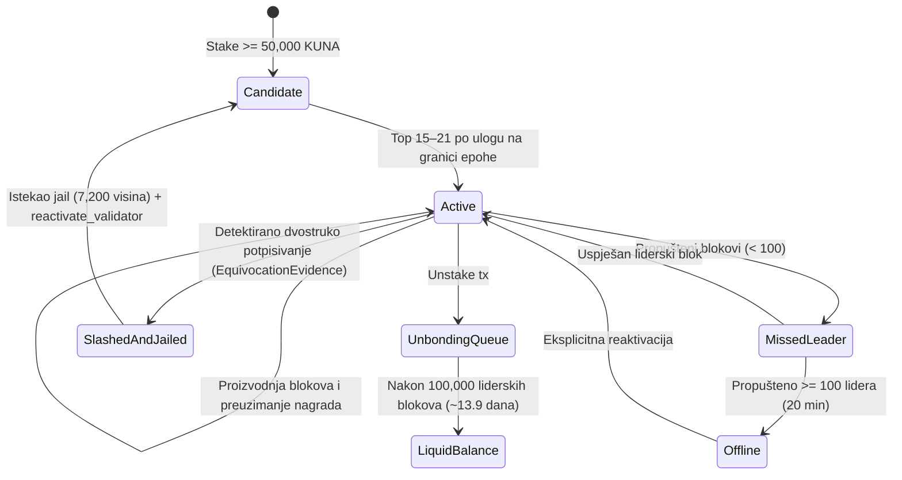

# RFC-003 — Staking, Epoch Transitions & Validator Lifecycle

- **Status:** Canonical / Active (Ground-Truth Specification)
- **Crate Scope:** `kovanica-staking`, `kovanica-types`, `kovanica-crypto`
- **Primary References:**
  - Staking engine: [`crates/kovanica-staking/src/lib.rs`](file:///crates/kovanica-staking/src/lib.rs)
  - Light client lottery: [`crates/kovanica-staking/src/light.rs`](file:///crates/kovanica-staking/src/light.rs)
  - Committee definitions: [`crates/kovanica-types/src/committee.rs`](file:///crates/kovanica-types/src/committee.rs)
  - Slashing evidence: [`crates/kovanica-types/src/evidence.rs`](file:///crates/kovanica-types/src/evidence.rs)
  - Slashing RFC: [`docs/rfcs/RFC-010-PRODUCTION-SLASHING.md`](file:///docs/rfcs/RFC-010-PRODUCTION-SLASHING.md)
  - Tokenomics summary: [`docs/TOKENOMICS.md`](file:///docs/TOKENOMICS.md), [`AGENTS.md`](file:///AGENTS.md)

---

## 1. Sažetak (Executive Summary)

RFC-003 definira ekonomski i operativni model Proof-of-Stake konsenzusa na Kovanica blockchainu. Kovanica koristi fiksnu, nepromjenjivu tokenomiku s ukupnom ponudom od $90\,200\,000\text{ KUNA}$ (9 decimala) i modelom poticaja koji se mintaju **isključivo** autoru potvrđenog bloka lidera (`CommittedSubDag`).

Aktivni validatorski set broji između 15 i 21 čvora s minimalnim ulogom od $50\,000\text{ KUNA}$. Sustav se rotira u epohama od $7\,200$ DAG rundi ($2\,400$ visina potvrđenih lidera $\approx 8\text{ sati}$). Validator koji napravi dokazano dvostruko potpisivanje (ekvivokaciju) biva deterministički kažnjen rezanjem od $5\%$ uloga (`SLASH_PCT_BPS = 500`), trenutnim uklanjanjem iz komiteta i zatvaranjem u zatvor (jail) na $7\,200$ liderskih visina ($\approx 24\text{ sata}$).

---

## 2. Zaključana tokenomika (Locked Invariants)

Svi parametri monetarne politike definirani su u `crates/kovanica-staking/src/lib.rs:38-96` i striktno su zaključani:

| Parametar | Vrijednost u kodu | Numerička vrijednost (Atomi / Base Units) |
|---|---|---|
| Ticker valute | `KUNA` | — (9 decimala, $1\text{ KUNA} = 10^9\text{ atoma}$) |
| Ukupna maksimalna ponuda | `TOTAL_SUPPLY` | $90\,200\,000 \times 10^9\text{ atoma}$ ($90.2\text{M}$) |
| Premine osnivača | `FOUNDER_PREMINE` | $200\,000 \times 10^9\text{ atoma}$ ($0.2\text{M}$) |
| Alokacija za genesis validatore | `GENESIS_VALIDATOR_ALLOCATION` | $1\,000\,000 \times 10^9\text{ atoma}$ ($1.0\text{M}$ podijeljeno jednako) |
| Riznica (Treasury total) | `TREASURY_TOTAL` | $8\,000\,000 \times 10^9\text{ atoma}$ ($8.0\text{M}$) |
| Godišnje otključavanje riznice | `TREASURY_ANNUAL` | $1\,000\,000 \times 10^9\text{ atoma}$ ($1\text{M/godina}$ kroz 8 godina) |
| Rudarski budžet (Mining Subsidy) | `MINING_SUBSIDY_BUDGET` | $81\,000\,000 \times 10^9\text{ atoma}$ ($81.0\text{M}$) |
| Početna nagrada po bloku | `INITIAL_BLOCK_REWARD` | $2.5 \times 10^9\text{ atoma}$ ($2.5\text{ KUNA}$) |
| Duljina ere subvencije | `SUBSIDY_ERA_BLOCKS` | $8\,100\,000$ potvrđenih liderskih blokova |
| Faktor opadanja (Decay) | `DECAY_NUM / DECAY_DEN` | $\times 3/4$ na kraju svake ere |
| Interval potvrđenog lidera | `LEADER_INTERVAL_SECS` | $12\text{ sekundi}$ ($3 \text{ runde} \times 4\text{ s}$) |
| Blokova u godini | `BLOCKS_PER_YEAR` | $31\,536\,000 / 12 = 2\,628\,000$ blokova |

### 2.1 Formula raspodjele nagrada i opadanja
Za danu visinu potvrđenog lidera $h$, era se računa kao $e = \lfloor h / 8\,100\,000 \rfloor$.
Nagrada za visinu $h$ iznosi:
$$R(h) = 2.5 \times \left(\frac{3}{4}\right)^e \text{ KUNA}$$
Ako se dogodi preljev ili nagrada padne na 0, nagrada ostaje 0. Zbroj svih mintanih nagrada kroz povijest asimptotski teži prema $81\,000\,000\text{ KUNA}$, garantirajući očuvanje hard-capa od $90\,200\,000\text{ KUNA}$.

---

## 3. Životni ciklus validatora (Validator Lifecycle)



### 3.1 Registracija i delegiranje
- **Minimalni ulog validatora:** `MIN_VALIDATOR_STAKE = 50_000 * ONE_KUNA` (`crates/kovanica-staking/src/lib.rs:102`).
- **Aktivni skup validatora:** `MIN_ACTIVE_VALIDATORS = 15`, `MAX_ACTIVE_VALIDATORS = 21`. Samo čvorovi unutar ovog raspona sudjeluju u kvorumu za potpisivanje blokova i glasova.
- **Period odvezivanja (Unbonding Period):** `UNBONDING_ROUNDS = 100_000` potvrđenih blokova lidera ($\approx 13.9\text{ dana}$). Tijekom ovog razdoblja sredstva ne ostvaruju prinos i ostaju podložna rezanju ako se otkrije prekršaj počinjen dok je čvor bio aktivan.
- **Provizija validatora:** Mijenja se transakcijom `SetCommission`. Zaštitni razmak promjene je `COMMISSION_CHANGE_COOLDOWN = 3 * EPOCH_LEADER_HEIGHTS = 7_200` blokova ($\approx 24\text{ sata}$), čime se onemogućuje manipuliranje delegatorima uoči isplate.

---

## 4. Epohe i rotacija komiteta (Epoch Transitions)

U sustavu Kovanica postoje dva usklađena brojača epohe koji traju identično vrijeme:

1. **Konsenzusna epoha (`epoch_for_round`):**
   $$\text{epoch} = \lfloor \text{round} / 7\,200 \rfloor$$
   Koristi se za domenske separatore potpisa glasova, timeouta i snimanja stanja komiteta (`EPOCH_COMMITTEE`).
2. **Izvršna epoha stanja (`epoch_for_height`):**
   $$\text{epoch} = \lfloor \text{height} / 2\,400 \rfloor$$
   Budući da jedan val traje $W=3$ runde, $7\,200$ rundi generira točno $2\,400$ potvrđenih lidera ($\approx 8\text{ sati}$). Koristi se za obračun laganih čvorova (Light set), vesting riznice i evaluaciju aktivnog skupa.

Na granici epohe (`is_epoch_start_height(height) == true`):
- Sortiraju se svi validatori po efektivnom ulogu (vlastiti ulog + ulog delegatora).
- Bira se top 15 do 21 validator za sljedeći komitet.
- Izračunava se kvorum:
  $$Q = \left\lfloor \frac{2 \times \text{total\_stake}}{3} \right\rfloor + 1$$

---

## 5. Mehanizam rezanja (Production Slashing & Jail)

Sukladno specifikaciji `RFC-010-PRODUCTION-SLASHING.md` i `crates/kovanica-staking/src/lib.rs`:

### 5.1 Dokaz o ekvivokaciji (`EquivocationEvidence`)
Čvor prijavljuje zlonamjernog validatora transakcijom `TransactionKind::Evidence`:
```rust
pub struct SignedBlockHeader {
    pub author: Address,
    pub round: Round,
    pub digest: Hash,
    pub signature: Signature,
}

pub struct EquivocationEvidence {
    pub header_a: SignedBlockHeader,
    pub header_b: SignedBlockHeader,
}
```
Pravila verifikacije (`evidence.verify()`):
1. `header_a.author == header_b.author` (isti počinitelj).
2. `header_a.round == header_b.round` (ista runda u DAG-u).
3. `header_a.digest != header_b.digest` (dva različita bloka).
4. Oba potpisa su kriptografski validna pod autorovim Ed25519 javnim ključem.
5. Ni jedan heš nije nulti heš.

### 5.2 Posljedice rezanja
Kada se dokaz primijeni u stanju:
1. **Financijska kazna:** Oduzima se $5\%$ (`SLASH_PCT_BPS = 500`) ukupnog uloga validatora i svih njegovih delegatora. Oduzeta sredstva automatski se prebacuju u saldo riznice (`TREASURY`).
2. **Deaktivacija:** Validator se trenutačno uklanja iz aktivnog skupa komiteta (`active = false`, `slashed = true`).
3. **Jail (Zatvor):** Postavlja se `jailed_until_height = current_height + JAIL_ROUNDS` ($7\,200$ blokova $\approx 24\text{ sata}$).
4. Za vrijeme trajanja zatvora, sve transakcije ponovnog ulaganja ili reaktivacije bivaju automatski odbačene. Nakon isteka zatvora, validator mora poslati eksplicitnu novu transakciju ulaganja s ulogom $\ge 50\,000\text{ KUNA}$ kako bi se vratio na listu kandidata.

---

## 6. Distribucija nagrada i lagani čvorovi (Light Set)

Prilikom svakog potvrđenog lidera (`CommittedSubDag`), izvršni sloj poziva:
`staking_state.on_leader_committed(leader_author, committed_height)`:

1. **Podjela liderske nagrade:**
   - Ako je aktivan Light Witness (VRF lutrija laganih čvorova): $5\%$ nagrade (`LIGHT_REWARD_BPS = 500`) dodjeljuje se autoru pobjedničkog VRF dokaza (`crates/kovanica-staking/src/light.rs:21`).
   - Preostalih $95\%$ dodjeljuje se autoru bloka lidera.
2. **Provizija i delegatori:**
   - Validator zadržava postotak definiran svojom provizijom (`commission_bps`).
   - Ostatak se proporcionalno pripisuje delegatorima u tablicu `staking_pending_rewards`.
3. **Linearni vesting riznice:**
   - Sa svakim potvrđenim blokom otključava se:
     $$\Delta_{\text{treasury}} = \frac{1\,000\,000 \times 10^9}{2\,628\,000} \approx 380\,517\text{ atoma KUNA}$$
   - Zaključana sredstva postaju dostupna adresi riznice putem transakcije `ClaimTreasury`.

---

## 7. Točne reference u kodu

- Tokenomika i konstante emisije: [`crates/kovanica-staking/src/lib.rs:38-96`](file:///crates/kovanica-staking/src/lib.rs#L38-L96)
- Ulaganje, provizija i unbonding: [`crates/kovanica-staking/src/lib.rs:101-169`](file:///crates/kovanica-staking/src/lib.rs#L101-L169)
- Izračun nagrade bloka (`block_reward`): [`crates/kovanica-staking/src/lib.rs:179-190`](file:///crates/kovanica-staking/src/lib.rs#L179-L190)
- Logika rezanja i zatvora: [`crates/kovanica-staking/src/lib.rs:380-420`](file:///crates/kovanica-staking/src/lib.rs#L380-L420)
- Struktura dokaza ekvivokacije: [`crates/kovanica-types/src/evidence.rs:15-80`](file:///crates/kovanica-types/src/evidence.rs#L15-L80)
- Integracija laganih čvorova i VRF-a: [`crates/kovanica-staking/src/light.rs:20-75`](file:///crates/kovanica-staking/src/light.rs#L20-L75)
