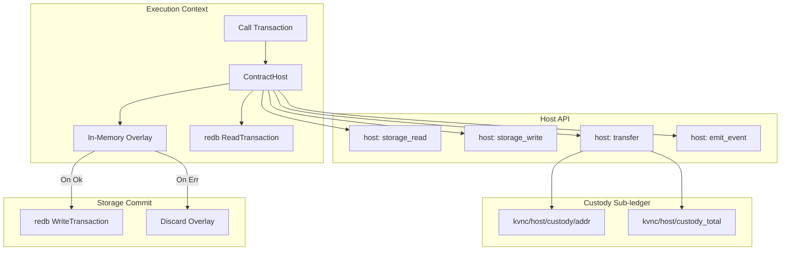

# RFC-004 — Execution Engine & Wasmi Host Environment

- **Status:** Canonical / Active (Ground-Truth Specification)
- **Crate Scope:** `kovanica-execution`, `kovanica-runtime`, `kovanica-common`, contract crates (`htlc`, `vault`, `multisig`, `token`, `name-registry`)
- **Primary References:**
  - Execution pipeline: [`crates/kovanica-execution/src/lib.rs`](file:///crates/kovanica-execution/src/lib.rs)
  - Contract host layer: [`crates/kovanica-execution/src/contracts.rs`](file:///crates/kovanica-execution/src/contracts.rs)
  - Argument encoding: [`crates/kovanica-execution/src/call_args.rs`](file:///crates/kovanica-execution/src/call_args.rs)
  - Wasmi interpreter runtime: [`crates/kovanica-runtime/src/lib.rs`](file:///crates/kovanica-runtime/src/lib.rs)
  - Contract traits & ABI: [`crates/kovanica-common/src/lib.rs`](file:///crates/kovanica-common/src/lib.rs), [`crates/kovanica-common/src/wasm.rs`](file:///crates/kovanica-common/src/wasm.rs)
  - Specifications: [`docs/CONTRACTS.md`](file:///docs/CONTRACTS.md), [`docs/GAS_SCHEDULE.md`](file:///docs/GAS_SCHEDULE.md)

---

## 1. Sažetak (Executive Summary)

RFC-004 specificira izvršni sloj (Execution Engine) i determinističko virtualno okruženje bazirano na Wasmi interpretatoru. Izvršni sloj obrađuje transakcije iz potvrđenog liderskog pod-grafa (`CommittedSubDag`) strogo definiranim topološkim redoslijedom.

Sustav podržava dva komplementarna modela izvršavanja pametnih ugovora koji dijele identičan stanje-host model (`ContractHost`):
1. **Wasmi sandboxed dispatch:** Sigurno, plinski mjereno izvođenje proizvoljnog WebAssembly koda (cdylib, `wasm32-unknown-unknown`).
2. **Native typed dispatch:** Izravno pozivanje ugrađenih, revidiranih ugovora (HTLC, Vault, Multisig, Token, Name Registry) uz identičan binarni izlaz i heš stanja kao Wasmi put.

Sve izmjene stanja odvijaju se u memorijskom sloju (overlay) unutar jedne `redb::WriteTransaction`. Izmjene se trajno bilježe isključivo ako poziv uspješno završi (`Ok`), dok se pri grešci (`ContractError` ili `RuntimeError`) svi privremeni upisi atomski odbacuju.

---

## 2. Transakcijski model (Transaction Specification)

Transakcija u Kovanici definirana je u `crates/kovanica-types/src/transaction.rs`:

```rust
pub struct Transaction {
    pub sender: Address,
    pub nonce: u64,
    pub kind: TransactionKind,
    pub fee: u64,
    pub signature: Signature,
    pub hash: Hash,
}
```

### 2.1 Podržane varijante (`TransactionKind`)

| Vrsta transakcije | Opis i semantika | Naknada (Fee) |
|---|---|---|
| `Transfer { to, amount }` | Izravni prijenos nativnih KUNA u baznim jedinicama (atomima). | Obavezna |
| `Stake { amount }` | Povećanje vlastitog uloga validatora. | Besplatno (0 fee po dizajnu) |
| `Unstake { amount }` | Pokretanje unbonding procesa ($100\,000$ blokova lidera). | Obavezna |
| `Delegate { validator, amount }` | Delegiranje uloga registriranom validatoru. | Besplatno (0 fee po dizajnu) |
| `ClaimRewards { validator }` | Isplata dospjelih nagrada od delegiranja. | Obavezna |
| `Deploy { code }` | Postavljanje novog WASM ugovora na lanac. | Obavezna + Gas |
| `Call { contract, value, method, args, gas_limit }` | Poziv metode ugovora s priloženom vrijednosti `value`. | Obavezna + Gas |
| `RegisterLightNode { vrf_public_key, stake }` | Registracija VRF ključa za lutriju laganih čvorova. | Obavezna |
| `ExitLightNode` | Izlazak iz seta laganih čvorova i povrat pologa. | Obavezna |
| `SubmitLightWitness { epoch, vrf_hash, vrf_proof }` | Predaja ECVRF dokaza za nagradu laganog čvora. | Obavezna |
| `SetCommission { validator, commission_bps }` | Podešavanje provizije validatora (cooldown $7\,200$ blokova). | Obavezna |
| `ClaimTreasury { amount }` | Povlačenje otključanih sredstava u riznicu. | Obavezna |
| `Evidence { evidence }` | Predaja dokaza o dvostrukom potpisivanju za rezanje uloga. | Obavezna |

### 2.2 Priložena vrijednost (`Call.value`)
Sukladno formatu potpisa v1 (`SIGNATURE_FORMAT.md`), polje `value` u `Call` transakciji omogućuje atomski prijenos KUNA s pošiljatelja na ugovor prije ulaska u metodu ugovora. Ako ugovor odbije transakciju, vraća se i priložena vrijednost.

---

## 3. Mjerenje plina i raspored troškova (Gas Metering)

Wasmi interpretator koristi determinističko mjerenje goriva (`fuel`):
- **Gornja granica plina po transakciji:** `MAX_TX_GAS_LIMIT = 10_000_000` (`crates/kovanica-types/src/lib.rs:146`).
- **Instrukcijski plin:** Svaka izvršena Wasmi instrukcija konzumira 1 jedinicu plina.
- **Memorijska ograničenja:**
  - Standardna WASM stranica iznosi $64\text{ KiB}$.
  - Maksimalna veličina međuspremnika argumenata/rezultata: `MAX_BUFFER_BYTES = 64 * 1024 * 1024` ($64\text{ MiB}$).
  - Gornja granica memorije gosta određena je preko `StoreLimitsBuilder`.
- **Cijena bajta koda (Bytecode floor):** Prilikom poziva ugovora minimalni plin mora pokriti trošak učitavanja:
  $$\text{gas\_limit} \ge \text{code\_len} \times \text{GAS\_PER\_MODULE\_BYTE}$$
- **Pravilo neuspjeha (Revert):** Ako poziv potroši sav plin (`OutOfGas`), transakcija se proglašava neuspjelom, cjelokupni uplaćeni plin se oduzima pošiljatelju kao naknada za procesorski rad, a stanje ugovora se vraća u početno stanje.

---

## 4. Wasmi Host okruženje i arhitektura skrbništva (Custody Ledger)



### 4.1 Semantika `ContractHost` sustava (`crates/kovanica-execution/src/contracts.rs:17-100`)
- **Imutabilni kontekst:** Adresa ugovora, adresa pozivatelja (`caller`), visina bloka, timestamp.
- **Izolirani prostori ključeva (Namespaced Storage):**
  Svaki upis ugovora u bazu sprema se pod ključem:
  $$\text{Key} = \text{Address}_{\text{contract}} \parallel \text{BLAKE3}(\text{raw\_key})$$
  Time je zajamčeno da dva ugovora s istim internim identifikatorima nikada ne mogu pregaziti podatke jedan drugome.
- **Rezervirani prefiks skrbništva (`RESERVED_HOST_PREFIX = "kvnc/host/"`):**
  Ugovor ne može izravno pristupiti adresi koja počinje ovim prefiksom. Pristup generira ljepljivu grešku (`sticky error`) i poništava poziv.
- **Pravila prijenosa sredstava (`Host::transfer`):**
  1. *Vlastita sredstva ugovora:* Ugovor može trošiti samo saldo umanjen za iznos koji drži u skrbništvu za treće strane (`balance - custody_total`).
  2. *Sredstva pozivatelja:* Do visine nepotrošene priložene vrijednosti (`Call.value`).
  3. *Oslobađanje pologa:* Debiting iz virtualne stavke skrbništva podugovora i kreditiranje stvarnog korisničkog računa.

### 4.2 WebAssembly Host uvozi (`env` modul u `kovanica-common/src/wasm.rs`)
- `kovanica_storage_read(key_ptr, key_len, val_ptr, val_cap) -> i64`
- `kovanica_storage_write(key_ptr, key_len, val_ptr, val_len) -> i32`
- `kovanica_caller(out_ptr) -> ()`
- `kovanica_value() -> u64`
- `kovanica_transfer(to_ptr, amount) -> i32`
- `kovanica_emit_event(topic_ptr, topic_len, data_ptr, data_len) -> ()`

---

## 5. Nativni ugovori sustava (Native Contracts)

Kovanica standardno isporučuje pet revidiranih, optimiziranih ugovora koji se mogu izvršavati nativno ili kompilirano u WASM:

```
crates/
├── kovanica-htlc           # Hash Time-Locked Contracts
├── kovanica-vault          # Timelock & Linear Vesting Vaults
├── kovanica-multisig       # M-of-N Multisignature Wallets
├── kovanica-token          # Fungible Token (KRC-20)
└── kovanica-name-registry  # Decentralized Name Service
```

### 5.1 Sažetak funkcionalnosti nativnih ugovora

1. **HTLC (`kovanica-htlc`):**
   - `htlc_create(claimer, amount, hash_lock, expiry)`: Zaključava sredstva uz BLAKE3 heš tajne (`preimage`) i vremenski rok.
   - `htlc_claim(id, preimage)`: Otključava sredstva predočenjem tajne prije isteka roka.
   - `htlc_refund(id)`: Vraća sredstva pošiljatelju nakon isteka roka.
2. **Vault (`kovanica-vault`):**
   - `vault_create(recipient, amount, schedule)`: Postavlja linearni ili cliff vesting raspored.
   - `vault_claim(id)`: Podiže dospjeli dio otključanih sredstava.
   - `vault_cancel(id)`: Opoziv od strane ovlaštenog kreatora (uz isplatu zarađenog dijela primatelju).
3. **Multisig (`kovanica-multisig`):**
   - `multisig_create(owners, threshold)`: Inicijalizira $M$-od-$N$ novčanik.
   - `multisig_propose(target, value, data)`: Stvara novi prijedlog transakcije.
   - `multisig_confirm(proposal_id)`: Potvrđuje prijedlog od strane vlasnika.
   - `multisig_execute(proposal_id)`: Izvršava transakciju nakon dostizanja praga $M$.
4. **Token (`kovanica-token`):**
   - Implementacija standardnih operacija zamjenjivog tokena: `token_create`, `token_transfer`, `token_approve`, `token_transfer_from`, `token_mint`, `token_burn`.
5. **Name Registry (`kovanica-name-registry`):**
   - Registracija imena `.kuna`, obnova i usmjeravanje na Kovanica adrese (`RFC-008-NAME-REGISTRY.md`).

---

## 6. Deterministička pravila i sigurnost

1. **Zabrana reentrancy napada:** Svaki poziv odvija se unutar izolirane instance; ugovor ne može pozivati samog sebe u rekurzivnom povratnom toku bez eksplicitnog prolaza kroz upravljani host mehanizam.
2. **Zaštita od prepisivanja memorije (Buffer Overflow):** Pokazivači i duljine koji dolaze iz WASM gosta provjeravaju se protiv granica dodijeljene linearne memorije (`wasm_memory.data(&store)`).
3. **Rollback atomičnost:** Prilikom pada Wasmi izvođenja (npr. trap, panic, dijeljenje s nulom ili istek plina), redb snapshot jamči da niti jedan bajt promjene ne prelazi u bazu podataka.

---

## 7. Točne reference u kodu

- Glavna petlja izvršavanja: [`crates/kovanica-execution/src/lib.rs:1-120`](file:///crates/kovanica-execution/src/lib.rs#L1-L120)
- Upravljanje ContractHostom i skrbništvom: [`crates/kovanica-execution/src/contracts.rs:17-150`](file:///crates/kovanica-execution/src/contracts.rs#L17-L150)
- Serijalizacija argumenata ugovora: [`crates/kovanica-execution/src/call_args.rs:1-85`](file:///crates/kovanica-execution/src/call_args.rs#L1-L85)
- Wasmi runtime i kontrola goriva: [`crates/kovanica-runtime/src/lib.rs:25-95`](file:///crates/kovanica-runtime/src/lib.rs#L25-L95)
- Zajednički ABI i importi: [`crates/kovanica-common/src/wasm.rs:1-120`](file:///crates/kovanica-common/src/wasm.rs#L1-L120)
- Nativni ugovori:
  - HTLC logika: [`crates/kovanica-htlc/src/lib.rs`](file:///crates/kovanica-htlc/src/lib.rs)
  - Vault logika: [`crates/kovanica-vault/src/lib.rs`](file:///crates/kovanica-vault/src/lib.rs)
  - Multisig logika: [`crates/kovanica-multisig/src/lib.rs`](file:///crates/kovanica-multisig/src/lib.rs)
  - Token logika: [`crates/kovanica-token/src/lib.rs`](file:///crates/kovanica-token/src/lib.rs)
