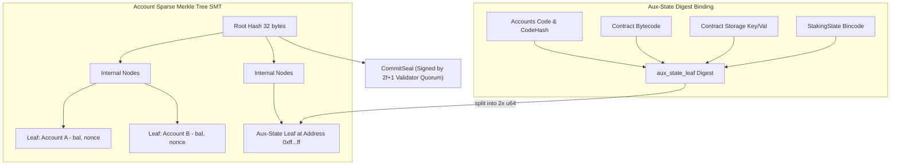
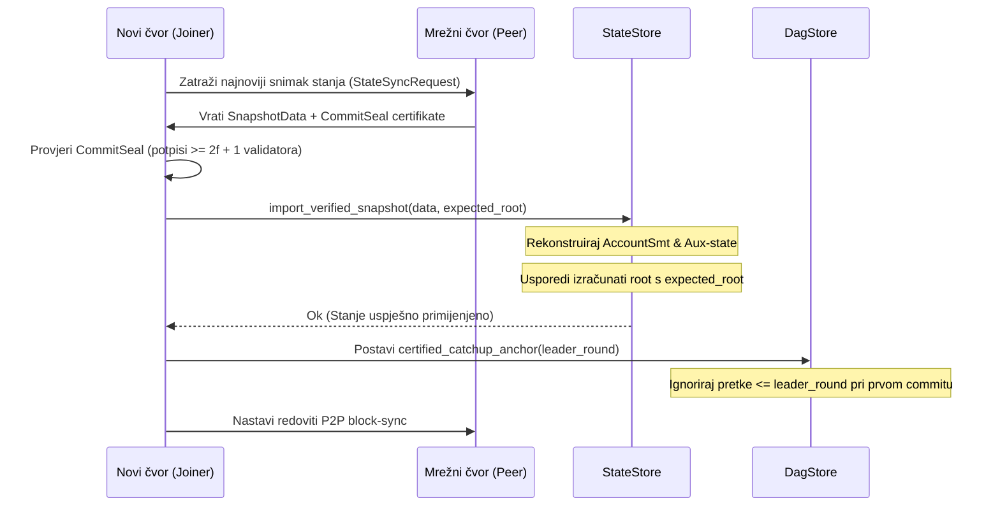

# RFC-005 — State Commitment, Pruning & Verifiable State Sync

- **Status:** Canonical / Active (Ground-Truth Specification)
- **Crate Scope:** `kovanica-storage`, `kovanica-types`, `kovanica-network`
- **Primary References:**
  - State store engine: [`crates/kovanica-storage/src/state_store.rs`](file:///crates/kovanica-storage/src/state_store.rs)
  - Storage main handle: [`crates/kovanica-storage/src/lib.rs`](file:///crates/kovanica-storage/src/lib.rs)
  - Account Sparse Merkle Tree: [`crates/kovanica-types/src/account_tree.rs`](file:///crates/kovanica-types/src/account_tree.rs)
  - Light client commitment & seals: [`crates/kovanica-types/src/light_client.rs`](file:///crates/kovanica-types/src/light_client.rs)
  - Network state sync: [`crates/kovanica-network/src/state_sync.rs`](file:///crates/kovanica-network/src/state_sync.rs)

---

## 1. Sažetak (Executive Summary)

RFC-005 specificira mehanizme kriptografskog obvezivanja stanja (State Commitment), politiku upravljanja trajnom pohranom i rezanjem povijesti (Pruning), te protokol provjerljive brze sinkronizacije (Verifiable State Sync).

Za razliku od klasičnih Merkle-Patricia stabala, Kovanica koristi kombinirani Sparse Merkle Tree (`AccountSmt`) temeljen na BLAKE3 heš funkciji, nadopunjen mehanizmom "pomoćnog lista stanja" (`aux-state leaf binding`). Ovaj mehanizam omogućuje da jedno 256-bitno Merkle korijensko sidro (`state_root`) deterministički veže ne samo stanja računa i noncee, već i cjelokupnu pohranu pametnih ugovora, bajtkod ugovora i globalno stanje ulaganja (`StakingState`).

Čvorovi koji se naknadno priključuju mreži mogu primijeniti provjereni snimak stanja (`SnapshotData`), provjeriti autentičnost korijena kroz kvorum post-izvršnih pečata (`CommitSeal`) i nastaviti rad bez potrebe za ponovnim procesiranjem transakcija od samog genesisa.

---

## 2. Sparse Merkle Tree i Aux-State Leaf Binding



### 2.1 Struktura stabla računa (`AccountSmt`)
Definirana u `crates/kovanica-types/src/account_tree.rs`:
- Dubina stabla: 256 razina (indeksirano prema 32-bajtnoj adresi računa).
- Heš lista za račun $A$ sa saldom $B$ i nonceom $N$:
  $$\text{LeafHash} = \text{BLAKE3}(\text{"KUNA/account/v1"} \parallel A \parallel B_{\text{LE}} \parallel N_{\text{LE}})$$
- Omogućuje generiranje kompaktnih dokaza uključenosti (`AccountProof`) za lagane klijente i vanjske verifikatore.

### 2.2 Povezivanje cjelokupnog stanja (`aux_state_leaf`)
Budući da osnovno stablo računa bilježi samo saldo i nonce, ostali dijelovi stanja vezuju se u stablo preko rezervirane adrese (`crates/kovanica-storage/src/state_store.rs:100`):
- **Rezervirana adresa:** `AUX_STATE_LEAF_ADDRESS = [0xff; 32]`
- **Domena:** `AUX_STATE_DOMAIN = b"KUNA/aux-state/v1"`
- **Izračun:**
  1. Prikupljaju se tablice: bajtkod ugovora (`contract_code`), pohrana ugovora (`contract_storage`), stanje ulaganja (`staking_state`) i računi s kodom.
  2. Izračunava se Merkle korijen tih tablica (`rows_root`).
  3. Generira se digest:
     $$\text{Digest} = \text{BLAKE3}(\text{AUX\_STATE\_DOMAIN} \parallel \text{rows\_root})$$
  4. Prvih 16 bajtova digesta dijeli se na dva 64-bitna broja:
     - `balance = u64::from_le_bytes(digest[0..8])`
     - `nonce = u64::from_le_bytes(digest[8..16])`
  5. Ova dva broja upisuju se u `AccountSmt` na adresu `[0xff; 32]`.
- **Sigurnosno jamstvo:** Bilo kakva manipulacija ugovorima ili stanjem ulaganja mijenja digest na adresi `[0xff; 32]`, što automatski čini korijen stanja nevažećim u odnosu na kvorumski potpisane pečate validatora.

---

## 3. Arhitektura baze podataka (`redb`)

Kovanica koristi ugrađenu `redb` ACID bazu podataka s podrškom za viševarijantnu kontrolu konkurentnosti (MVCC):

| Tablica | Ključ | Vrijednost | Svrha |
|---|---|---|---|
| `ACCOUNTS` | `[u8; 32]` (adresa) | `Account` (bincode) | Saldo, nonce, heš koda ugovora. |
| `CONTRACT_CODE` | `[u8; 32]` (code hash) | `Vec<u8>` (WASM bajtovi) | Pohranjeni WebAssembly kod. |
| `CONTRACT_STORAGE` | `[u8; 64]` (addr $\parallel$ key) | `Vec<u8>` | Pohrana podataka po ugovoru. |
| `STAKING_STATE` | `u8` (konstanta `0`) | `StakingState` (bincode) | Globalno stanje Proof-of-Stakea. |
| `STATE_ROOT` | `u64` (liderska visina) | `[u8; 32]` (Merkle root) | Povijest korijena stanja. |
| `BLOCKS` | `[u8; 32]` (block hash) | `StatementBlock` | Trajno spremljeni blokovi. |
| `VOTES` | `(Round, AuthorityIndex)` | `Vote` | Trajno spremljeni konsenzusni glasovi. |
| `TX_RECEIPTS` | `u64` (liderska visina) | `Vec<u8>` (bincode) | Potvrde o izvršenju transakcija. |
| `TX_RECEIPT_BY_HASH` | `[u8; 32]` (tx hash) | `Vec<u8>` | Indeks potvrda za brzi RPC dohvat. |

---

## 4. Politika rezanja povijesti (Pruning Strategy)

Kako bi se očuvao ciljani memorijski otisak od 2–4 GB RAM-a na poslužitelju, Kovanica primjenjuje agresivnu politiku čišćenja povijesnih podataka koji više nisu potrebni za očuvanje konsenzusa:

### 4.1 Rezanje DAG povijesti (`prune_waves_before` / `prune_below`)
- Parametar prozora: `prune_window_waves` (zadano 100 valova $\approx 300$ DAG rundi).
- **Uvjet korektnosti:** Rezanje mora biti "zatvoreno prema dolje" (downward-closed). Ako se briše runda $R$, moraju se obrisati svi blokovi s rundom $\le R$.
- Sprječava stvaranje rupa u povijesti predaka što bi moglo uzrokovati dvostruko izvršavanje već predanih blokova.

### 4.2 Rezanje povijesti korijena stanja
- Konfiguracija: `max_state_roots = 2000` (`crates/kovanica-storage/src/state_store.rs:78`).
- Čuva se zadnjih 2000 korijena stanja (dovoljno za verifikaciju nedavnih reorijentacija i laganih klijenata); stariji zapisi se automatski uklanjaju.

---

## 5. Provjerljiva brza sinkronizacija (Verifiable State Sync)

Kada čvor zaostaje više stotina tisuća blokova ili se prvi put pokreće, sinkronizacija cijelog DAG-a bila bi dugotrajna. Protokol `state_sync` omogućuje preuzimanje kompaktnog snimka:



### 5.1 Format snimka stanja (`SnapshotData`)
- **Magični prefiks:** `SNAPSHOT_MAGIC = *b"KVSNSP01"` (8 bajtova).
- **Verzija formata:** `SNAPSHOT_VERSION = 1`.
- **Struktura podataka:**
  ```rust
  pub struct SnapshotData {
      pub version: u32,
      pub height: u64,
      pub accounts: Vec<(Vec<u8>, Vec<u8>)>,
      pub contract_code: Vec<(Vec<u8>, Vec<u8>)>,
      pub contract_storage: Vec<(Vec<u8>, Vec<u8>)>,
      pub staking_state: Vec<u8>,
      pub state_root: [u8; 32],
  }
  ```

### 5.2 Verifikacija i sidro ulova (`certified_catchup_anchor`)
Prilikom uvoza kroz `StateStore::import_verified_snapshot`:
1. Iz uvezenih tablica ponovno se izračunava stablo računa i `aux_state_leaf`.
2. Izvedeni Merkle korijen mora biti identičan polju `state_root` koje je potpisao komitet.
3. Ako verifikacija prođe, `DagStore` postavlja `certified_catchup_anchor(leader_round)`. Prilikom sljedeće odluke konsenzusa, funkcija `uncommitted_history` preskače sve blokove predaka s rundom manjom ili jednakom sidru, čime se eliminira mogućnost ponovnog izvršenja transakcija koje su već sadržane u snimku.

---

## 6. Sigurnosni mehanizmi

1. **Zaštita od krivotvorenih snimaka:** Neprovjereni snimci (stari format ili neslaganje heša) automatski se odbijaju s greškom `SnapshotVerify`.
2. **Imutabilnost povijesti:** Pohrana u `redb` koristi ACID transakcije s provjerom integriteta stranica, sprječavajući djelomične zapise uslijed iznenadnog nestanka napajanja čvora.
3. **Izolacija nultih računa:** Računi sa saldom 0, nonceom 0 i bez koda preskaču se u stablu, sprječavajući napade popunjavanjem praznih čvorova radi napuhavanja Merkle stabla.

---

## 7. Točne reference u kodu

- Upravljanje stanjem i snapshot logika: [`crates/kovanica-storage/src/state_store.rs:70-170`](file:///crates/kovanica-storage/src/state_store.rs#L70-L170)
- Izračun aux-state digesta: [`crates/kovanica-storage/src/state_store.rs:114-143`](file:///crates/kovanica-storage/src/state_store.rs#L114-L143)
- Sparse Merkle Tree implementacija: [`crates/kovanica-types/src/account_tree.rs:15-120`](file:///crates/kovanica-types/src/account_tree.rs#L15-L120)
- Definicija i verifikacija pečata: [`crates/kovanica-types/src/light_client.rs:40-95`](file:///crates/kovanica-types/src/light_client.rs#L40-L95)
- Tablice trajne pohrane: [`crates/kovanica-storage/src/lib.rs:35-50`](file:///crates/kovanica-storage/src/lib.rs#L35-L50)
- Sidro ulova u committeru: [`crates/kovanica-consensus/src/committer.rs:209-221`](file:///crates/kovanica-consensus/src/committer.rs#L209-L221)
