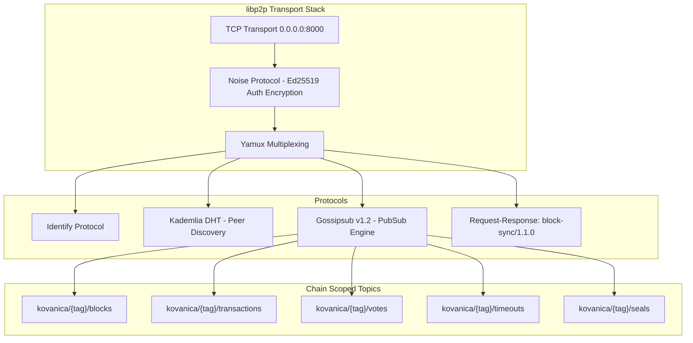

# RFC-006 — P2P Network Protocol & Mempool Specification

- **Status:** Canonical / Active (Ground-Truth Specification)
- **Crate Scope:** `kovanica-network`, `kovanica-mempool`, `kovanica-types`
- **Primary References:**
  - Network service: [`crates/kovanica-network/src/service.rs`](file:///crates/kovanica-network/src/service.rs)
  - Gossipsub topics: [`crates/kovanica-network/src/topics.rs`](file:///crates/kovanica-network/src/topics.rs)
  - Block sync protocol: [`crates/kovanica-network/src/block_sync.rs`](file:///crates/kovanica-network/src/block_sync.rs)
  - Peer scoring & validation: [`crates/kovanica-network/src/scoring.rs`](file:///crates/kovanica-network/src/scoring.rs), [`crates/kovanica-network/src/validation.rs`](file:///crates/kovanica-network/src/validation.rs)
  - Mempool engine: [`crates/kovanica-mempool/src/lib.rs`](file:///crates/kovanica-mempool/src/lib.rs)
  - Related RFC: [`docs/rfcs/RFC-009-VOTE-TRANSFER-OVER-BLOCK-SYNC.md`](file:///docs/rfcs/RFC-009-VOTE-TRANSFER-OVER-BLOCK-SYNC.md)

---

## 1. Sažetak (Executive Summary)

RFC-006 definira mrežni sloj čvora (Peer-to-Peer komunikacija bazirana na `libp2p` stogu) i mehanizam raspoređivanja transakcija u radnoj memoriji (Mempool).

Mrežni sloj osigurava šifriran, autentificiran i otporan prijenos blokova, glasova, timeouta i transakcija preko protokola Gossipsub v1.2, uz strogu izolaciju različitih lanaca (Chain-Scoped Network IDs) kako bi se spriječilo križanje poruka između glavne mreže, testneta i lokalnih razvojnih okruženja. Protokol za sinkronizaciju blokova (`block-sync/1.1.0`) omogućuje točkasti (point-to-point) dohvat povijesti i glasova zaostalim čvorovima.

Mempool upravlja transakcijama primjenjujući strogu politiku prioritizacije prema stopi naknade (fee-rate), podržava zamjenu transakcija po principu Replace-By-Fee (RBF) uz minimalni postotak povećanja naknade, te štiti čvor od DoS napada brzom provjerom bez opterećivanja baze podataka.

---

## 2. libp2p mrežni stog i izolacija lanca

Mrežna arhitektura konfigurirana je u `crates/kovanica-network/src/behaviour.rs` i `service.rs`:



### 2.1 Mrežni identifikatori i razdvajanje tema (`NetworkId`)
Svaka Gossipsub tema na žici dobiva prefiks koji uključuje ID lanca i prefiks heša genesis bloka (`crates/kovanica-network/src/topics.rs`):
$$\text{WireTopic} = \text{"kovanica/"} \parallel \text{chain\_id} \parallel \text{"-"} \parallel \text{genesis\_prefix} \parallel \text{"/"} \parallel \text{topic\_name}$$

Popis osnovnih tema:
1. `blocks`: Distribucija punih `StatementBlock` blokova.
2. `transactions`: Distribucija nepotvrđenih `Transaction` transakcija.
3. `votes`: Konsenzusni glasovi validatora za liderske blokove.
4. `timeouts`: Timeout poruke i `SkipCert` certifikati (PRO-40 (b)).
5. `seals`: Kvorumski pečati potvrđenih korijena stanja (`CommitSeal`).
6. `sync`: Emitiranje signala zaostajanja.
7. `state_sync`: Zahtjevi za snimkom stanja.

---

## 3. Protokol sinkronizacije blokova (`block-sync/1.1.0`)

Definiran u `crates/kovanica-network/src/block_sync.rs`. Koristi libp2p Request-Response ponašanje za izravnu komunikaciju čvor-prema-čvoru:
- **Identifikator protokola:** `/kovanica/<chain_tag>/block-sync/1.1.0`
- **Maksimalna veličina poruke:**
  - Zahtjev: `MAX_REQUEST_SIZE = 1024` bajtova.
  - Odgovor: `MAX_RESPONSE_SIZE = 1024 * 1024` ($1\text{ MiB}$).

```rust
pub enum BlockSyncRequest {
    ByHash(Hash),
    ByAuthorRound { author: AuthorityIndex, round: Round },
    Status,
    RoundRange { from: Round, to: Round }, // max 32 rounds per request
    VotesForRound { round: Round },        // RFC-009 late-join catch-up
}

pub enum BlockSyncResponse {
    Block(StatementBlock),
    NotFound,
    InvalidRequest,
    MissingBlocks(Vec<Hash>),
    RoundHashes { up_to_round: Round, hashes: Vec<Hash> },
    TipRound(Round),
    Votes { votes: Vec<Vote> },
}
```

Čitanje dolaznih tokova je strogo ograničeno funkcijom `read_bounded` kako zlonamjerni čvor ne bi mogao izazvati preopterećenje memorije slanjem neograničenog niza bajtova.

---

## 4. Arhitektura transakcijskog mempoola (`kovanica-mempool`)

Mempool (`crates/kovanica-mempool/src/lib.rs`) služi kao privremeno spremište i mehanizam sortiranja transakcija prije njihovog uvrštavanja u blok.

```mermaid
graph TD
    IN[Dolazna Transakcija] --> V1[1. Veličina, plin, minimalna stopa naknade]
    V1 --> V2[2. tx.hash == tx.signing_hash()]
    V2 --> V3[3. Provjera duplikata heša u bazenu]
    V3 --> V4[4. Ed25519 provjera potpisa pod domenskim tagom]
    V4 --> V5[5. Stanje računa: kontinuirani nonce niz, saldo pošiljatelja]
    V5 --> ADMIT{Prolazi?}
    ADMIT -->|Da| POOL[PoolState: by_fee_rate / by_sender]
    ADMIT -->|RBF| REPLACE[Replace-By-Fee ako je fee >= bump %]
    ADMIT -->|Ne| REJECT[Odbij s MempoolError]
```

### 4.1 Pravila prijema transakcija (Admission Pipeline)
Kako bi se resursi trošili optimalno, provjere se izvode od najjeftinijih (stateless) prema najskupljima (stateful):
1. **Format i granice:** Veličina serijalizirane transakcije mora biti $\le \text{max\_tx\_size}$. Plin za `Call` mora biti $\le \text{MAX\_TX\_GAS\_LIMIT}$ ($10\,000\,000$).
2. **Pravilo naknada:**
   - Transakcije tipa `Stake` i `Delegate` su **besplatne po dizajnu** (`requires_fee == false`).
   - Sve ostale transakcije moraju platiti naknadu čija stopa po bajtu zadovoljava `min_fee_rate`.
3. **Kriptografska veza:** `tx.hash` mora odgovarati stvarnom hešu potpisanog sadržaja (`tx.signing_hash()`).
4. **Verifikacija potpisa:** Ed25519 potpis se provjerava pod kontekstom odgovarajućeg lanca (`SigningContext`).
5. **Kontinuitet nonce-a:** Za svakog pošiljatelja transakcije u mempoolu moraju formirati strogo uzastopni niz koji počinje od trenutnog stanja na računu (`account.nonce`).

### 4.2 Pravilo zamjene (Replace-By-Fee — RBF)
Ako u mempool stigne transakcija s istim pošiljateljem i istim nonceom kao već postojeća:
- Nova transakcija se prihvaća samo ako nudi naknadu veću za najmanje `replacement_fee_bump_percent` (zadano $10\%$).
- Prethodna transakcija se uklanja, a nova zauzima njeno mjesto u indeksima.

### 4.3 Životni ciklus transakcije u mempoolu
1. **Queued:** Transakcija čeka u redu po stopi naknade (`by_fee_rate`).
2. **In Flight:** Predlagatelj bloka poziva `get_next_transactions` i uzima transakciju za prijedlog novog bloka. Postavlja se vremenska oznaka `in_flight_since`.
3. **Commit:** Kada blok koji sadrži transakciju postane dio potvrđenog `CommittedSubDag`, izvršni sloj poziva `remove_committed_transactions` i transakcija se trajno uklanja.
4. **Requeue Timeout:** Ako transakcija u letu ne bude potvrđena unutar `in_flight_timeout` (zadano npr. 60 sekundi), automatski se vraća u red čekanja (`requeue_stale`).
5. **Reinsert iz crvenih blokova:** Transakcije iz neuspjelih ("crvenih") blokova konsenzusa ponovno se ubacuju bez slanja na gossip (`gossip=false`), čime se korisnicima štedi ponovno slanje.

---

## 5. Mrežno bodovanje i DoS zaštita (Peer Scoring)

U modulu `crates/kovanica-network/src/scoring.rs` implementirano je praćenje ponašanja mrežnih susjeda:
- **Validne poruke:** Povećavaju reputaciju čvora.
- **Prekršaji i kazne:**
  - Slanje neispravnog bloka ili lošeg potpisa donosi trenutačnu negativnu ocjenu i prekid veze.
  - Slanje malicioznih transakcija koje padaju na potpisima rezultira blokiranjem IP adrese na određeno vrijeme.
  - Slanje poruka većih od $1\text{ MiB}$ automatski prekida vezu.

---

## 6. Točne reference u kodu

- Konfiguracija mrežnog servisa: [`crates/kovanica-network/src/service.rs:50-210`](file:///crates/kovanica-network/src/service.rs#L50-L210)
- Definicije Gossipsub tema: [`crates/kovanica-network/src/topics.rs:1-50`](file:///crates/kovanica-network/src/topics.rs#L1-L50)
- Protokol sinkronizacije blokova: [`crates/kovanica-network/src/block_sync.rs:25-130`](file:///crates/kovanica-network/src/block_sync.rs#L25-L130)
- Prijem i prioritizacija u mempoolu: [`crates/kovanica-mempool/src/lib.rs:75-230`](file:///crates/kovanica-mempool/src/lib.rs#L75-L230)
- Konfiguracija i granice mempoola: [`crates/kovanica-mempool/src/lib.rs:794-825`](file:///crates/kovanica-mempool/src/lib.rs#L794-L825)
- Vraćanje transakcija iz crvenih blokova: [`crates/kovanica-mempool/src/lib.rs:286-310`](file:///crates/kovanica-mempool/src/lib.rs#L286-L310)
