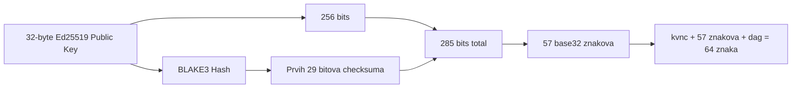
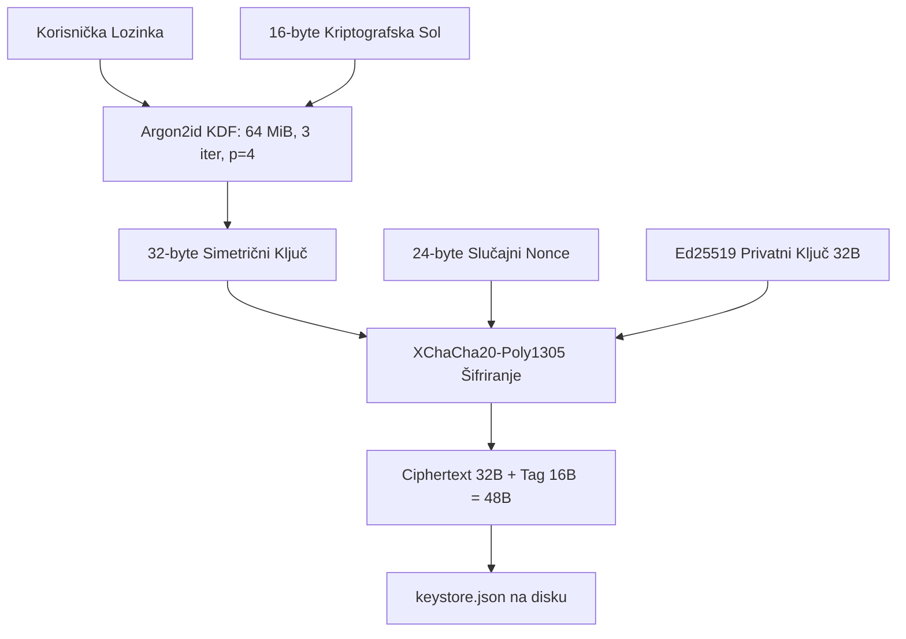

# RFC-007 — RPC & Keystore Specification

- **Status:** Canonical / Active (Ground-Truth Specification)
- **Crate Scope:** `kovanica-rpc`, `kovanica-keystore`, `kovanica-types`
- **Primary References:**
  - RPC server & routing: [`crates/kovanica-rpc/src/lib.rs`](file:///crates/kovanica-rpc/src/lib.rs)
  - Standard chain methods: [`crates/kovanica-rpc/src/chain_methods.rs`](file:///crates/kovanica-rpc/src/chain_methods.rs)
  - Contract handlers: [`crates/kovanica-rpc/src/rpc_methods.rs`](file:///crates/kovanica-rpc/src/rpc_methods.rs)
  - Middleware & security: [`crates/kovanica-rpc/src/rpc_middleware.rs`](file:///crates/kovanica-rpc/src/rpc_middleware.rs)
  - Keystore engine: [`crates/kovanica-keystore/src/lib.rs`](file:///crates/kovanica-keystore/src/lib.rs)
  - File permissions: [`crates/kovanica-keystore/src/perms.rs`](file:///crates/kovanica-keystore/src/perms.rs)
  - Address encoding rules: [`crates/kovanica-types/src/address.rs`](file:///crates/kovanica-types/src/address.rs)

---

## 1. Sažetak (Executive Summary)

RFC-007 specificira korisničko i klijentsko sučelje za interakciju s Kovanica čvorom. Obuhvaća poslužitelj JSON-RPC 2.0 i WebSocket API-je (`kovanica-rpc`), kanonski bech32 format adresa računa (`Address`) s pravilima prihvaćanja legacy formata, te kriptografsku specifikaciju novčanika za pohranu privatnih ključeva (`kovanica-keystore` v2).

Komunikacijsko sučelje prati Ethereum JSON-RPC konvencije gdje je to prikladno (heksadecimalne količine s prefiksom `0x`), uz dodatak specijaliziranih Kovanica metoda za uvid u DAG stanje, raspored lidera i verifikaciju pečata komiteta. Zaštita privatnih ključeva na disku implementira industrijski standard Argon2id u kombinaciji s authenticated encryption algoritmom XChaCha20-Poly1305, uz strogo nametanje OS prava pristupa (0600 / DACL).

---

## 2. Kanonski format adrese i rukovanje legacy adresama

Kovanica koristi sirovi 32-bajtni Ed25519 javni ključ kao identifikator računa, čime se omogućuje izravna provjera valjanosti potpisa transakcije bez potrebe za čuvanjem zasebne tablice javnih ključeva.



### 2.1 Kanonski bech32 format (PRO-21, zaključano)
- **Prefiks:** `kvnc` (4 znaka)
- **Sufiks:** `dag` (3 znaka)
- **Tijelo:** 57 znakova iz bech32 abecede (`qpzry9x8gf2tvdw0s3jn54khce6mua7l`, mala slova).
- **Duljina:** Fiksno točno **64 znaka**.
- **Struktura bita:**
  $$\text{Bitovi} = 256\text{ bita (ključ)} + 29\text{ bita (BLAKE3(ključ))} = 285\text{ bita}$$
  $$285 / 5 = 57\text{ base32 simbola bez paddinga.}$$
- **Parsiranje (`FromStr`):** Strogi parser prihvaća isključivo ovaj oblik. Bilo koji oblik koji ne sadrži točno 64 znaka ili ima pogrešan 29-bitni kontrolni zbroj odbija se s greškom `AddressError`.

### 2.2 Pravila prihvaćanja legacy formata (`legacy_address_allowed`)
Definirano u `crates/kovanica-types/src/address.rs:35`:
- **Dopušteni lanci:**
  - Devnet (`chain_id = 3`)
  - Testnet v2 (`chain_id = 4`)
  - Local (`chain_id = 1337`)
  Na ovim lancima klijenti smiju slati starije heksadecimalne oblike (`kvnc<hex>dag` ili čisti 64-hex ključ s prefiksom `0x`).
- **Zabranjeni lanci:**
  - Mainnet (`chain_id = 1`)
  - Javni testnet (`chain_id = 2`)
  - Bilo koji drugi ID lanca.
  Na ovim lancima legacy adrese se bezuvjetno odbijaju s greškom `AddressError::LegacyNotAllowed(chain_id)`.

---

## 3. JSON-RPC 2.0 API specifikacija

RPC poslužitelj podiže se preko Axum frameworka (zadano na `127.0.0.1:8545`). Svi zahtjevi moraju biti valjani JSON-RPC 2.0 objekti.

### 3.1 Standardni kodovi grešaka (`RpcError`)

| Kod | Naziv | Opis |
|---|---|---|
| `-32700` | `ParseError` | Neispravan JSON format u tijelu zahtjeva. |
| `-32600` | `InvalidRequest` | Objekt ne zadovoljava JSON-RPC 2.0 shemu. |
| `-32601` | `MethodNotFound` | Metoda ne postoji u registru. |
| `-32602` | `InvalidParams` | Parametri nisu valjani (npr. neispravna adresa, nedostaje polje). |
| `-32603` | `InternalError` | Neočekivani pad ili greška internog podsustava čvora. |
| `-32000` | `ExecutionError` | Transakcija je odbačena u izvršnom sloju ili ugovoru. |
| `-32001` | `Unauthorized` | Zahtjev nema valjan autorizacijski token (za zaštićene rute). |
| `-32003` | `Timeout` | Izvršavanje poziva premašilo je `RPC_REQUEST_TIMEOUT = 10s`. |
| `-32004` | `NotImplemented` | Metoda je rezervirana, ali još nije aktivirana. |

---

## 4. Pregled ključnih RPC metoda

### 4.1 Lanac, blokovi i stanje

```
kovanica_blockNumber() -> "0x..."
kovanica_getBlockByNumber(height, full_tx) -> BlockObject
kovanica_getBlockByHash(hash, full_tx) -> BlockObject
kovanica_getBalance(address) -> "0x..." (količina atoma u hexu)
kovanica_getNonce(address) -> "0x..." (sljedeći očekivani nonce)
kovanica_getCode(address) -> "0x..." (WASM bytecode u hexu)
kovanica_getStorageAt(address, key) -> "0x..." (vrijednost ugovorne pohrane)
```

### 4.2 Transakcije i mempool

```
kovanica_sendRawTransaction(raw_bytes) -> Hash
kovanica_getTransactionByHash(hash) -> TransactionObject
kovanica_getTransactionReceipt(hash) -> ReceiptObject
kovanica_getTransactionHistory(query) -> TxHistoryPage
kovanica_getPendingTransactions() -> Vec<TransactionObject>
kovanica_estimateFee(tx) -> "0x..."
```

### 4.3 DAG, konsenzus i validatori

```
kovanica_getValidators() -> Vec<ValidatorInfo>
kovanica_getStake(validator_address) -> StakeObject
kovanica_getRewards(delegator, validator) -> "0x..."
kovanica_getLeaderSchedule(count) -> Vec<LeaderScheduleSlot>
kovanica_getCommittee(epoch) -> CommitteeObject
kovanica_getLeaderHeader(round) -> LeaderHeaderObject
kovanica_getCommitSeals(height) -> Vec<CommitSeal>
```

### 4.4 WebSocket pretplate (`/ws`)
Klijenti mogu otvoriti persistentnu WebSocket vezu i pretplatiti se na asinkrone događaje:
- `newHeads`: Emitira se pri svakom potvrđenom bloku lidera.
- `logs`: Emitira filtrirane događaje ugovora (`ContractEvent`).
- `pendingTransactions`: Emitira heševe novih transakcija koje ulaze u mempool.

---

## 5. Sigurnost RPC-a i zaštitni posrednici (Middleware)

U `crates/kovanica-rpc/src/rpc_middleware.rs` implementirani su sigurnosni slojevi:
1. **Ograničavanje stope zahtjeva (Rate Limiting):**
   - Sprječava preopterećenje poslužitelja ograničavanjem broja zahtjeva po IP adresi u vremenskom prozoru.
2. **CORS zaštita:**
   - Prema zadanim postavkama prihvaćaju se samo ovlaštene origini za web konzolu (`CONSOLE_ALLOWED_ORIGINS`).
3. **Zaštita operacija pisanja (`WRITE_METHODS`):**
   - Metode poput `kovanica_sendRawTransaction` mogu se dodatno konfigurirati s autorizacijskim ključem ako se čvor nalazi iza javnog proxyja.

---

## 6. Kriptografska specifikacija novčanika (Keystore v2)

Modul `crates/kovanica-keystore` pruža sigurnu trajnu pohranu privatnih ključeva na disku:



### 6.1 Parametri verzije 2 (`KEYSTORE_VERSION = 2`)
- **Algoritam izvođenja ključa (KDF):** Argon2id (RFC 9106 profil za memorijski ograničena okruženja):
  - Memorija: `KDF_MEMORY_KIB = 65_536` ($64\text{ MiB}$).
  - Broj iteracija: `KDF_ITERATIONS = 3`.
  - Paralelizam: `KDF_PARALLELISM = 4` dretve.
  - Duljina soli: `SALT_LEN = 16` bajtova.
- **Autentificirano šifriranje:** XChaCha20-Poly1305:
  - Duljina nonce-a: `NONCE_LEN = 24` bajta (kriptografski siguran pseudoslučajni generator `OsRng`).
  - Duljina šifrata: `CIPHERTEXT_LEN = 48` bajtova (32 bajta ključa + 16 bajtova Poly1305 autentifikacijske oznake).
- **Zaštita memorije:** Svi privatni podaci u radnoj memoriji omotani su u `Zeroizing<T>` tipove koji garantiraju prepisivanje memorije nulama (`zeroize`) prilikom uništavanja objekta (`Drop`).

### 6.2 Kontrola prava pristupa datotekama (`perms.rs`)
Kako bi se spriječilo da drugi procesi ili korisnici na istom poslužitelju pročitaju datoteku novčanika:
- **Unix sustavi:** Funkcija `ensure_owner_only` provjerava i postavlja mod `0600` (isključivo čitanje i pisanje od strane vlasnika). Datoteka se odbija otvoriti ako grupa ili ostali korisnici imaju prava čitanja.
- **Windows sustavi:** Funkcija `tighten_private_file` postavlja diskrecijsku listu kontrole pristupa (DACL) dodjeljujući puna prava samo trenutnom korisničkom SID-u, dok se prava za `Everyone` i `Authenticated Users` uklanjaju.

---

## 7. Točne reference u kodu

- Pokretanje i registar RPC metoda: [`crates/kovanica-rpc/src/lib.rs:40-160`](file:///crates/kovanica-rpc/src/lib.rs#L40-L160)
- Rukovanje standardnim chain pozivima: [`crates/kovanica-rpc/src/chain_methods.rs:1-120`](file:///crates/kovanica-rpc/src/chain_methods.rs#L1-L120)
- Posrednički sloj i rate limiting: [`crates/kovanica-rpc/src/rpc_middleware.rs:1-85`](file:///crates/kovanica-rpc/src/rpc_middleware.rs#L1-L85)
- Keystore v2 enkripcija i KDF: [`crates/kovanica-keystore/src/lib.rs:25-95`](file:///crates/kovanica-keystore/src/lib.rs#L25-L95)
- Sigurnosna prava pristupa datotekama: [`crates/kovanica-keystore/src/perms.rs:1-80`](file:///crates/kovanica-keystore/src/perms.rs#L1-L80)
- Parsiranje i validacija bech32 adrese: [`crates/kovanica-types/src/address.rs:8-95`](file:///crates/kovanica-types/src/address.rs#L8-L95)
